# AgentPay Firewall — On-chain spending limits for AI agents

## Pitch
AI agents need crypto wallet keys. A single prompt injection or compromised key can drain the entire balance. AgentPay Firewall enforces per-agent per-transaction caps, daily budgets, recipient allowlists, and freeze controls so a hacked agent can only lose a bounded amount.

## The problem
An AI agent holds an ETH or ERC-20 wallet key. A malicious prompt, buggy code, or social-engineering attack can cause the agent to send all funds to an attacker address in one transaction. Traditional EOA wallets have no built-in limits.

## What AgentPay Firewall does
- **Per-transaction cap**: no single agent payment exceeds the set per-tx limit.
- **Daily budget**: total spent per 24‑hour window is enforced; excess is blocked.
- **Approved recipients only**: the agent can only send to addresses on its allowlist.
- **Freeze/unfreeze**: owner or guardian can instantly freeze an agent or all agents.
- **Request approval**: payments above the per‑tx cap go through a pending request that the owner must approve or reject.
- **Change‑delay queue**: loosening caps or adding recipients is queued with a delay the guardian can cancel, giving a window to respond if the owner key is stolen.

## Live demo on Sepolia
- AgentPay: `0xF24b16e7B4Aac61EeBBEa6BAb9817f35de2C7814` — [Etherscan contract page](https://sepolia.etherscan.io/address/0xF24b16e7B4Aac61EeBBEa6BAb9817f35de2C7814#code)
- Mock USDC: `0x5755Be7c5f4E0E13f1fd77d375402902DEA322Ec` — [Etherscan token page](https://sepolia.etherscan.io/token/0x5755Be7c5f4E0E13f1fd77d375402902DEA322Ec#code)
- Owner, Guardian, Agent, Merchant, and Attacker addresses are deployed on Sepolia and listed in `frontend/deployment.json`.

## Architecture

```mermaid
graph BT
  Owner((Owner)) -->|funds & sets policy| AgentPay[AgentPay Contract]
  Guardian((Guardian)) -->|can freeze / cancel| AgentPay
  Agent((Agent)) -->|calls agentPay / requestPayment| AgentPay
  Merchant((Merchant)) <-- payments --> AgentPay
  Attacker((Attacker)) <-- blocked --> AgentPay
  style AgentPay fill:#111827,stroke:#1F2A44,stroke-width:2px
  style Owner fill:#4F7CFF,color:#fff
  style Guardian fill:#F59E0B,color:#000
  style Agent fill:#4F7CFF,color:#fff
```


## How it works — check order in agentPay (6 steps)
1. **caller is an active agent** — the caller must match an active (non‑deactivated) agent policy.
2. **!globalFrozen && !agent.frozen** — neither the vault globally nor the specific agent may be frozen.
3. **recipient allowlisted** — the destination address must be on the agent's allowlist.
4. **amount ≤ perTxCap** — the payment must not exceed the per‑transaction cap.
5. **reset window if elapsed** — if the 24‑hour window has passed, spent is reset to 0.
6. **spent + amount ≤ dailyBudget** — the addition must not exceed the daily budget.
If all checks pass, the contract transfers the funds and emits `PaymentExecuted`.

## Roles table
| Role | Who can do what |
|------|-----------------|
| **Owner** | Funds vault, sets/queues policy changes, withdraws, approves/rejects requests, freezes/unfreezes agents/guardian changes |
| **Guardian** | Can freeze agents/global, cancel pending proposals — cannot move funds or change policy |
| **Agent** | Calls `agentPay` or `requestPayment` — subject to caps, budget, allowlist, freeze checks |
| **Viewer** | Any address not owner/guardian/agent — no on‑chain rights, UI shows viewer role |

## Tests
- 54 Hardhat + chai tests across 8 test files (including regression tests for the demo's human‑readable revert messages).
- Tests cover: custom errors, payment limits, per‑tx and daily budget enforcement, request queue/cancel, access control, freeze/unfreeze, proposal queue/execute/cancel, reentrancy resistance, fuzz invariants, and the revert‑message decoder.
- Run: `npm install && npm run node:local && npm run deploy:local && npm test`

## How to run locally
```powershell
# 1. Install dependencies
npm install

# 2. Start a local Hardhat node (keep this terminal open)
npm run node:local

# 3. Deploy to the local node (new terminal)
npm run deploy:local

# 4. Run all tests
npm test

# 5. Run the full before/after demo (fresh deployment each time)
npm run demo:reset
npm run demo:all

# 6. Run the simulated AI agent against the vault
npm run agent:demo
```
Notes:
- `demo:all` consumes the daily budget, so run `demo:reset` (redeploys) before each demo run.
- `npm run agent:demo` starts a local node, deploys, and runs `agent/agent.ts`: one allowed
  payment succeeds, then a prompt‑injected payment to a non‑allowlisted recipient is blocked
  on‑chain. (The agent is a simulation — no real LLM.)
- Useful checks: `npm run typecheck` (TypeScript, 0 errors), `npm run coverage`, `npm run gas`.

## How to run on Sepolia
```powershell
# Prerequisites: .env with PRIVATE_KEY, SEPOLIA_RPC_URL, ETHERSCAN_API_KEY
# and sufficient Sepolia ETH in the owner and demo agent keys.

# Deploy to Sepolia
npm run deploy:sepolia

# Verify on Etherscan (optional)
npx hardhat verify --contract contracts/AgentPay.sol --network sepolia <AgentPay-address>

# Start the frontend (serves against Sepolia deployment.json)
npm run ui
```
The frontend is available at `http://localhost:5173/`.

## Honest limitations
- AgentPay **limits damage from a misbehaving or stolen AGENT key**. It does **not** protect against a compromised OWNER key; the owner can still withdraw all funds. The guardian can freeze agents and cancel loosening changes, but only within the change‑delay window.
- The demo AI agent is **simulated**, not a real LLM. It uses a throwaway testnet key.
- Supports ETH and ERC‑20 only; fee‑on‑transfer tokens are not supported.
- Contract has not been audited by a third party; use on testnets only.
- Change‑delay mechanism relies on the guardian being online and trustworthy.

## Future work
- Withdraw delay (owner cannot move funds instantly after a policy loosening).
- Multisig or timelock owner.
- ERC‑7579 module‑style extensible policy.
- Interface for guardian‑only proposal review.